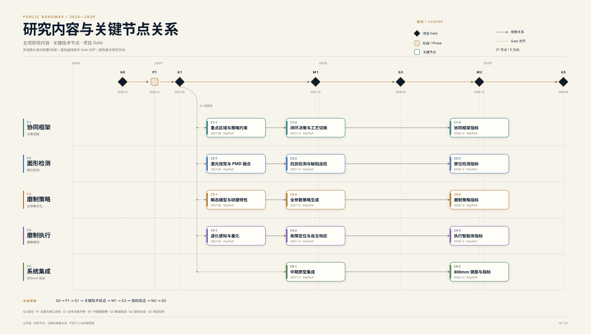

# 基于多智能体的大口径光学镜面精密制造与检测技术研发

江苏省前沿技术研发计划

> 本仓库是项目的公开信息层：发布公开通知和六个公开节点。

## 快速入口

| 内容 | 入口 |
|---|---|
| 项目网站源码 | [site/](site/) |
| 项目概览 | [docs/about.md](docs/about.md) |
| 项目动态 | [docs/notices.md](docs/notices.md) |
| 关键节点 | [docs/milestones.md](docs/milestones.md) |
| 研究内容与关键节点 | [docs/research-milestones.md](docs/research-milestones.md) |
| 公开看板 | [OptiForge_Public_Roadmap](https://github.com/users/iphytian/projects/1) |
| 提交公开通知 | Issues → New issue → **提交公开通知** |
| 更正/补充 | Issues → New issue → **更正/补充** |
| 发布规范 | [PUBLICATION-POLICY.md](PUBLICATION-POLICY.md) |

## 项目一览

<!-- STATS:START -->
- 公开节点：**6** 个
- 公开通知：**4** 条
- 最近更新：**2026-11-11**
<!-- STATS:END -->

项目由中国科学院南京天文光学技术研究所牵头，联合中国科学院工业人工智能研究所、中科院南京耐尔思光电仪器有限公司共同承担，执行期为 2026 年 7 月至 2029 年 6 月。

项目面向大口径光学镜面制造中多工序协同难、检测与加工脱节等瓶颈，构建大模型驱动的“检测—策略—执行—决策”多智能体协同框架，并在 800mm 级镜面上开展集成验证。

## 关键节点

<!-- MILESTONES:START -->
| 节点 | 名称 | 计划日期 | 状态 |
|---|---|---|---|
| G0 | 项目启动 | 2026-10-21 | ✅ 已完成 |
| G1 | 总体方案评审 | 2027-02-25 | 🔜 下一节点 |
| M1 | 中期里程碑 | 2027-12-24 | ○ 计划 |
| G3 | 集成联调完成 | 2028-06-30 | ○ 计划 |
| M2 | 主要指标达成 | 2028-12-22 | ○ 计划 |
| G5 | 项目验收 | 2029-06-27 | ○ 计划 |
<!-- MILESTONES:END -->

完整说明见 [docs/milestones.md](docs/milestones.md)。五项研究内容的关键技术与节点见 [docs/research-milestones.md](docs/research-milestones.md)。公开看板只展示阶段门、研究节点和公开交付物，不展示任务明细、风险清单和评审意见。



[查看原图](docs/assets/project-roadmap.svg)

## 最新通知

<!-- LATEST_NOTICES:START -->
- **2026-11-11** · [项目公开信息仓库上线](docs/notices/2026-11-11-public-repository.md)
- **2026-11-05** · [G1 总体方案评审调整至 2027 年 2 月](docs/notices/2026-11-05-g1-review.md)
- **2026-10-21** · [项目启动会暨 2026 年第一次工作会议召开](docs/notices/2026-10-21-kickoff.md)
<!-- LATEST_NOTICES:END -->

全部通知见 [docs/notices.md](docs/notices.md)。

## 如何提交

1. 打开 Issues → New issue，选择 **提交公开通知** 或 **更正/补充**。
2. 填写日期、分类、摘要和正文；只提交可公开的信息。
3. 维护者审核后，在 `docs/notices/` 新建 Markdown 文件，合并到 `main`。
4. 合并前在本地运行 `python3 scripts/build_docs.py`，把生成的 `README` 和通知/节点索引一起提交；PR 会校验生成文件是否最新。

详细规则见 [CONTRIBUTING.md](CONTRIBUTING.md) 和 [PUBLICATION-POLICY.md](PUBLICATION-POLICY.md)。

## 仓库结构

```text
data/milestones.csv       # 六个公开节点
docs/about.md             # 项目概览
docs/milestones.md        # 自动生成
docs/research-milestones.md # 研究内容、关键技术与节点
docs/assets/project-roadmap.svg # 关系图
docs/notices.md           # 自动生成
docs/notices/             # 公开通知原文
scripts/validate_data.py  # 公开性与字段校验
scripts/build_docs.py     # 生成索引与 README 统计
scripts/build_roadmap_svg.py # 生成关系图
.github/ISSUE_TEMPLATE/   # 提交通知、更正
.github/workflows/        # 校验、重建、月度快照
```

## 引用

如引用本项目的公开信息，建议使用：

> 项目组. 基于多智能体的大口径光学镜面精密制造与检测技术研发公开信息仓库. 2026. GitHub: `Jiangsu_optiforge`.

`CITATION.cff` 提供了仓库级引用信息，发布前请把占位组织名替换为实际 GitHub 组织。

## 许可与声明

- 代码与脚本：MIT，见 [LICENSE](LICENSE)。
- 项目原创文字与整理数据：保留所有权利，见 [CONTENT-LICENSE.md](CONTENT-LICENSE.md)。公开可读不等于授权再分发。
- 完整声明见 [DISCLAIMER.md](DISCLAIMER.md)。

## 维护

维护者：项目组 PMO / 信息管理员。  
维护者一次性配置见 [docs/maintainer-setup.md](docs/maintainer-setup.md)。  
公开仓库的合并、发布和可见性变更按 [PUBLICATION-POLICY.md](PUBLICATION-POLICY.md) 执行。

> 公开即永久：提交前请确认内容即使永久公开也没有问题。
